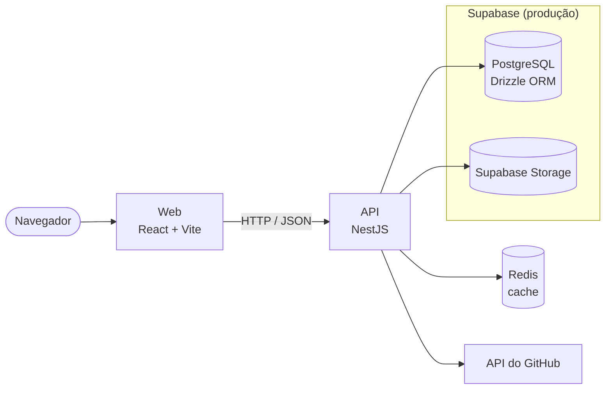

# CarecaHub

**Acesse a aplicação:** https://carecahub-web.onrender.com/

## Descrição

O CarecaHub é uma plataforma para apoiar turmas na organização de projetos
acadêmicos. Ela reúne estudantes, monitores, professores e administradores em
um único ambiente para formar grupos, cadastrar projetos e repositórios,
publicar atividades, acompanhar entregas e centralizar notificações.

## Aplicação publicada

- Web: https://carecahub-web.onrender.com/
- API: https://carecahub-api.onrender.com/

A publicação no Render é feita pela pipeline do Jenkins, na branch `main`. O
passo a passo está em [jenkins/README.md](jenkins/README.md#deploy-no-render).

## Arquitetura



Em produção, o PostgreSQL e o Storage ficam no Supabase. Localmente, o
PostgreSQL roda no Docker (`carecahub_db`).

- **Web** (`web/`): React, React Router, Vite, Tailwind e shadcn. Lê dados da
  API com SWR e envia alterações pela função `writer`. Nunca acessa o banco
  diretamente.
- **API** (`api/`): NestJS com Drizzle ORM. Cada recurso fica em
  `api/src/resources/` (`auth`, `users`, `groups`, `notification`, `projects`,
  `repositories`) e os serviços externos em `api/src/providers/`. A sessão usa
  JWT em cookies `httpOnly`.
- **Serviços usados pela API:**
  - PostgreSQL guarda os dados.
  - Redis guarda dados temporários, como os códigos de 2FA e os tokens de
    recuperação de senha.
  - O Supabase Storage guarda as imagens enviadas.
  - A API do GitHub fornece os dados públicos dos perfis e as estatísticas dos
    repositórios.
- **Entrega:** a cada pull request, o Jenkins roda lint, testes e build da API
  e do web. Na `main`, ele também aplica as migrations no banco do Supabase e
  publica a API e o web no Render.

## Requisitos funcionais

- Autenticar usuários e permitir a alteração de senha.
- Gerenciar usuários com os papéis de administrador, professor, monitor e
  aluno.
- Permitir a criação e administração de grupos de projeto.
- Permitir o cadastro, a consulta e a personalização de projetos e seus
  repositórios.
- Permitir que professores publiquem atividades, acompanhem entregas e
  avaliem submissões de grupos.
- Permitir que alunos visualizem atividades e enviem suas entregas.
- Exibir notificações de convites para grupos e atualizações de atividades.
- Exibir perfis de usuários com informações acadêmicas e dados públicos do
  GitHub quando disponíveis.

## Requisitos não funcionais

- A aplicação deve aplicar autorização por papel (role) em todas as operações da API.
- Senhas e credenciais não devem ser expostas em código, logs ou repositório;
  a configuração deve ser feita por variáveis de ambiente.
- A interface deve ser responsiva e utilizável em telas de diferentes tamanhos.
- Registros removidos devem ser preservados por exclusão lógica quando
  aplicável.
- A API e a interface web devem permanecer separadas, com contratos de dados
  tipados e validação de entradas.
- Funcionalidades críticas devem possuir testes automatizados de comportamento
  e autorização.

## Metodologia

O grupo adotou **Kanban, sem sprints**, porque:

- é mais simples que Scrum: não exige sprints, Scrum Master nem cerimônias
  fixas, e o próprio time define seus eventos;
- cada integrante pega cards conforme a sua disponibilidade, sem compromisso de
  entrega por sprint;
- o quadro mostra em que etapa está cada tarefa e onde há bloqueio.

### Quadro

Para gerenciar as fixtures a serem feitas no projeto, um board de cards chamado "CarecaHub - Tickets" foi criado no Trello e separado em 7 colunas.

BACKLOG --> TO DO --> STAND_BY --> WORKING --> PULL_REQUEST --> MERGED --> DONE

Cada card gerado descreve o escopo de atuação, como [ WEB ], [ API ] ou [ INTEGRAÇÃO ], um título descreve a implementação/ajuste, uma descrição detalhada do que precisa ser feito com seus critérios de aceite e tags aplicadas que definem se é ajuste ou implementação. Os cards são distribuídos entre os integrantes com atribuição exibida no Trello.

### Papéis

| Integrante | GitHub | Papel |
|---|---|---|
| Daniel Granato Botelho | Granato07 | Dev Backend |
| Felipe Soares dos Santos Silveira | Felipe-SSS | Dev Fullstack e Product Owner (detalhou a ideia do produto) |
| Isabelle Caroline Pereira | isacarol-04 | Dev Frontend |
| Lara Moreira Siécola | lara-ms | Dev Frontend |
| Pedro Henrique Santos de Oliveira | HSOPedro | Dev Backend |
| Rander Augusto Dias Lemos | RanderDLemos | Dev Fullstack |

Não houve Scrum Master, QA nem revisor fixo.

### Cadência e ferramentas

- Planejamento a cada 2 semanas, pelo WhatsApp.
- Trello: quadro Kanban.
- GitHub: código, pull requests e revisão.
- Jenkins: integração contínua e deploy.
- WhatsApp: comunicação e planejamento do grupo.

### Definição de preparado (DoR)

Um card pode ser pego quando tem escopo ([ WEB ], [ API ] ou [ INTEGRAÇÃO ]),
título, descrição do que precisa ser feito, critérios de aceite e a tag de
ajuste ou implementação.

### Definição de pronto (DoD)

1. Card movido para PULL_REQUEST.
2. Pull request aberto com o
   [template](.github/pull_request_template.md) preenchido.
3. Pipeline do Jenkins verde: lint, testes e build.
4. Aprovação de outro integrante.
5. Merge na `main` e card movido para MERGED e DONE.

### Métricas

Levantamento feito no GitHub em 13/11/2026, considerando os PRs #1 a #57.

- 57 pull requests: 56 mergeados e 1 fechado sem merge.
- PRs mergeados por mês: agosto 1, setembro 27, outubro 20 e novembro 8.
- Tempo entre abrir e mergear um PR (lead time): mediana de 2,3 h, média de
  14,2 h e máximo de 97,9 h.

## Dinâmica de desenvolvimento

### Divisão de tarefas

Os cards ficam no BACKLOG do Trello e cada integrante pega o que vai fazer. Em
casos específicos, Felipe Soares distribuía as tarefas.

### Branches e commits

- Cada tarefa tem uma branch criada a partir da `main`, com prefixo pelo tipo
  de mudança: `feat/`, `fix/`, `docs/`, `test/`, `refactor/` ou `chore/`.
- Toda mudança entra na `main` por pull request.
- Os commits seguem o padrão Conventional Commits (`feat`, `fix`, `docs`,
  `test`, `ci`, `style`, `refactor`).

### Code review

Depois que a integração contínua foi configurada, a `main` ganhou proteção de
branch: o merge exige 1 aprovação, de qualquer integrante.

### Bloqueios

- **Pipeline do Jenkins:** em 17/10 foram necessários vários ajustes seguidos
  (`fix(ci)`) até a pipeline rodar: executar os stages no agente herdado,
  validar API e web em builds sem PR e ajustar a descoberta de branches e PRs.
- **Lint no Windows:** com `core.autocrlf`, o Git grava os arquivos com fim de
  linha CRLF, e o Biome exige LF. Por isso o lint acusava erro localmente,
  enquanto na pipeline do Jenkins, que roda em Linux, ele passava.

Quando algo travava, o grupo se reorganizava conversando.

### Lições aprendidas

- Definir melhor as funcionalidades e o banco de dados antes de começar.
- Fazer um brainstorm no início para organizar as ideias e deixar todos no
  mesmo ponto.

## Histórias de usuário

As histórias completas, com critérios de aceite, estão em
[docs/stories](docs/stories).

| História | Prioridade | Status | Pull requests | Testes automatizados |
|---|---|---|---|---|
| [US-01 Autenticação de acesso](docs/stories/01-autenticacao.md) | Alta | Entregue | #8, #37 | `auth.service.test.ts`, `auth.guard.test.ts`, `login-page.test.tsx`, `password-input.test.tsx` |
| [US-02 Gerenciamento de usuários por papel](docs/stories/02-gerenciamento-de-usuarios.md) | Alta | Entregue | #1, #3, #4, #30, #32 | `user.service.test.ts`, `user.controller.test.ts`, `roles.guard.test.ts`, `user-analytics.test.ts` |
| [US-03 Formação de grupos de projeto](docs/stories/03-formacao-de-grupos.md) | Alta | Entregue | #20, #21, #26, #27, #29, #38 | `group.service.test.ts`, `notification-invite.service.test.ts`, `notification-response.service.test.ts`, `my-project-group-creation.test.tsx` |
| [US-04 Cadastro de projetos e repositórios](docs/stories/04-projetos-e-repositorios.md) | Alta | Entregue | #7, #15, #19, #28, #31, #39, #55, #56 | `project.service.test.ts`, `repository.service.test.ts`, `project-details-page.test.tsx`, `project-card.test.tsx` |
| [US-05 Publicação de atividades e entregas](docs/stories/05-atividades-e-entregas.md) | Alta | Entregue | #65, #66 | `activity.service.test.ts`, `submission.service.test.ts`, `activity-dtos.test.ts`, `activity-helpers.test.ts`, `activities-routes.test.tsx`, `student-submission-card.test.tsx` |
| [US-06 Central de notificações](docs/stories/06-notificacoes.md) | Média | Parcial: convites de grupo funcionam; publicar ou alterar uma atividade ainda não gera notificação | #29 | `notification.service.test.ts`, `notification-read-all.service.test.ts`, `notification-types.test.ts` |

## Refactorings

Cada integrante aplicou pelo menos 2 refactorings. Os testes e a pipeline
estavam verdes antes e depois de cada mudança.

| Integrante | Code smell | Refactoring aplicado | Por quê | PR |
|---|---|---|---|---|
| Isabelle | Código duplicado: imagem com fallback claro/escuro e estilo da `mainColor` copiados no card e nos detalhes do projeto, além de uma cópia local do `GitHubIcon` no card | Extrair componente `ProjectThumbnail` + função `projectAccentStyle` e reutilizar o `GitHubIcon` de `components/icons` | A regra de exibição da imagem do projeto fica em um componente só, usado pelas duas telas | [#55](https://github.com/C14-Inatel-2026-2/carecahub/pull/55) |
| Isabelle | Componente longo: `ProjectDetailsContent` com ~220 linhas e regra do "Outro" repetida para gerenciador e controle de versão | Extrair função (`optionOrOtherLabel`, `getProjectTechnologies`) + extrair componente (`ProjectMembersList`, `ProjectRepositoriesList`) | Cada parte da tela ganha nome e a regra do "Outro" fica isolada e testável | [#55](https://github.com/C14-Inatel-2026-2/carecahub/pull/55) |
| Lara | Componente longo e código duplicado: `create-project-page.tsx` tinha 3 blocos `Controller` + `Select` semelhantes | Extrair o componente `OptionSelectField` e a lista `sortedTechnologyOptions` | Centraliza a estrutura dos selects e reduz duplicação, mantendo os campos “Outro” logo abaixo dos respectivos campos | [#58](https://github.com/C14-Inatel-2026-2/carecahub/pull/58) |
| Lara | Números mágicos e código duplicado: tipos de imagem repetidos nos campos de arquivo e tamanho máximo sem nome | Criar `ACCEPTED_IMAGE_TYPES` e `MAX_IMAGE_SIZE_BYTES`; extrair `validateImage` e `uploadIfSelected` | Mantém a validação e os formatos aceitos dos campos de upload alinhados, evitando duplicação | [#60](https://github.com/C14-Inatel-2026-2/carecahub/pull/60) |
| Daniel | Código duplicado: detecção do erro 23505 do Postgres copiada como método privado em `group.service`, `project.service` e `repository.service` | Substituir os métodos privados pela função compartilhada `isUniqueViolation` de `utils/query-violations.ts` | A extração já existia pela metade: dois services usavam o utilitário e três mantinham cópias, então uma mudança na regra precisaria ser lembrada em cinco lugares | [#62](https://github.com/C14-Inatel-2026-2/carecahub/pull/62) |
| Daniel | Código duplicado: classe `QueryResult` (dublê do query builder do Drizzle) copiada em oito arquivos de teste, com cópias já divergindo nos métodos | Extrair classe para `utils/mocks/query-result.mock.ts` e reutilizar em cinco testes; as cópias que registram chamadas (spies, em `group` e `notification-response`) ficaram de fora | Mudar a forma de simular o banco exigia editar oito arquivos; antes de unificar, conferi que nenhum teste dependia da diferença no tratamento de erro entre as cópias | [#63](https://github.com/C14-Inatel-2026-2/carecahub/pull/63) |
| Felipe | Código duplicado entre módulos: diálogos, `UserActions` e colunas de Monitores copiados de Usuários | Extrair componente (`UserActions`, `user-columns`) e reutilizar os diálogos de `users` | Uma correção na tabela ou nos diálogos passa a valer para as duas telas | [#67](https://github.com/C14-Inatel-2026-2/carecahub/pull/67) |

## Como rodar localmente

Para apenas usar o sistema, acesse https://carecahub-web.onrender.com/.

### Pré-requisitos

- Docker (no Windows, o Docker Desktop aberto).
- Node.js. A pipeline usa a versão 24.
- pnpm. O projeto declara `pnpm@11.17.0`.

### 1. Banco de dados e Redis

Na raiz do repositório:

```bash
docker compose up -d carecahub_db carecahub_redis
```

O PostgreSQL fica na porta `5432` e o Redis na `6379`.

### 2. API

```bash
cd api
cp .env.example .env
```

No `api/.env`, defina pelo menos `JWT_SECRET`, `API_SECRET`,
`SEED_ADMIN_PASSWORD` e `SEED_USER_PASSWORD`. O `GITHUB_TOKEN` é usado para
buscar os dados do GitHub.

```bash
pnpm install
pnpm db:m
pnpm db:seed
pnpm dev
```

- `pnpm db:m` aplica as migrations no banco.
- `pnpm db:seed` cria os usuários e dados de exemplo.

A API sobe em `http://localhost:3000`.

### 3. Web

Em outro terminal:

```bash
cd web
cp .env.example .env
```

No `web/.env`, confira se `VITE_API_URL` aponta para a API:
`http://localhost:3000`.

```bash
pnpm install
pnpm dev
```

O web abre em `http://localhost:5173`.

### 4. Entrar

O seed cria estas contas:

| Papel | E-mail | Senha |
|---|---|---|
| Administrador | `admin@carecahub.local` | valor de `SEED_ADMIN_PASSWORD` |
| Monitor | `monitor.gabriel@carecahub.local` | valor de `SEED_USER_PASSWORD` |
| Aluno | `isabelle@carecahub.local` (e os demais alunos do seed) | valor de `SEED_USER_PASSWORD` |

### Testes, lint e build

Em `api/` ou `web/`:

```bash
pnpm test
pnpm lint
pnpm build
```

No Windows, o `pnpm test` da API não funciona no PowerShell nem no cmd, porque
o script usa a sintaxe `NODE_ENV=test`. Rode pelo Git Bash:

```bash
NODE_ENV=test npx vitest run
```

### Jenkins (opcional)

```bash
cp jenkins/.env.example jenkins/.env
docker compose up -d --build jenkins
```

Preencha o `jenkins/.env` antes de subir. O Jenkins fica em
`http://localhost:8080`. Os detalhes estão em [jenkins/README.md](jenkins/README.md).

---

Mantenha simples.
